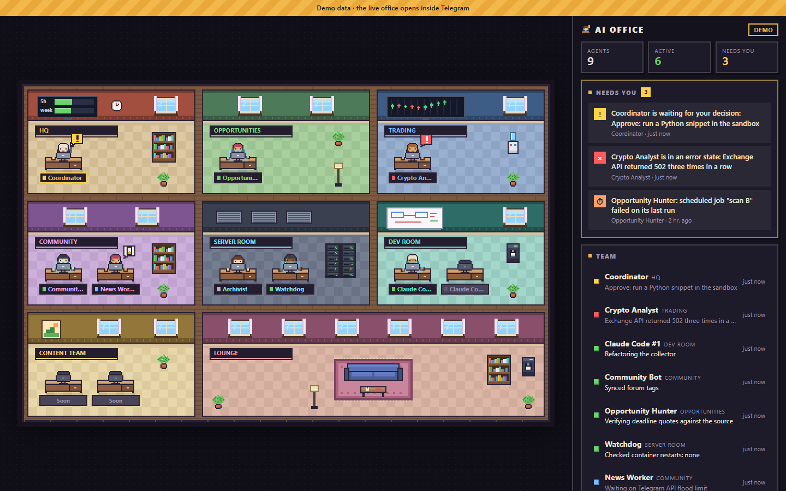
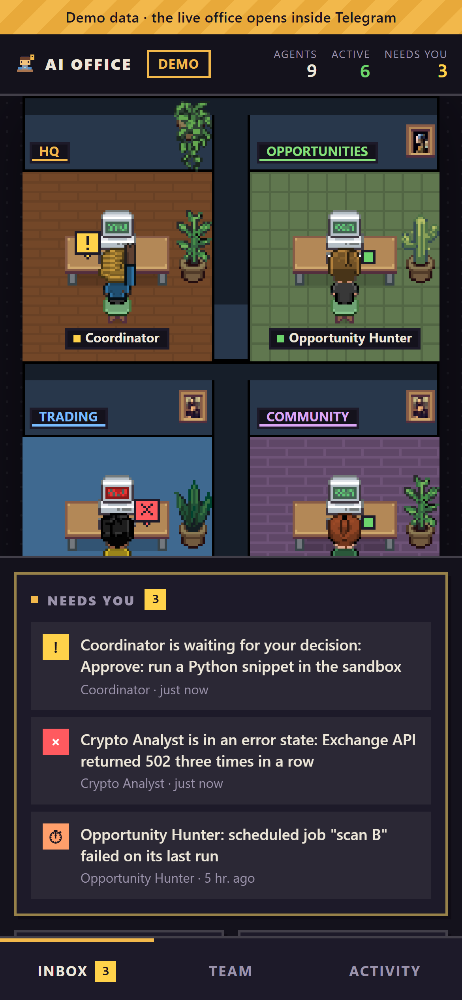

# AI Office

[](https://github.com/WorkD69/ai_office/actions/workflows/ci.yml)
[](LICENSE)

A pixel-art office for my personal AI agents. Each agent sits at a desk, and the office
shows in real time who is working, who is waiting for me, what failed, and how much model
quota is left. It runs as a **Telegram Mini App** on the phone and on the desktop.

The agents are [Hermes Agent](https://github.com/NousResearch/hermes-agent) profiles plus a few
plain bots and scripts. They run on a small VPS that **opens no inbound ports**.



<p align="center"></p>

**Live demo:** [ai-office.workd69.workers.dev](https://ai-office.workd69.workers.dev) (synthetic data).

> Outside Telegram the app shows a **synthetic demo**. Real data is available only to the owner,
> authenticated through Telegram.

## Why

A chat with a bot doesn't tell you what the agents behind it are doing. I wanted one screen that
answers three questions, in this order:

1. **What needs me right now?** Approvals, errors, failed scheduled jobs, agents that went offline.
2. **What is happening?** Who is working on what, a human-readable activity feed.
3. **What does it cost?** Model-quota windows (5 h / week) and today's token usage per agent.

The pixel office is the friendly surface on top. The same data is also available as an accessible
panel.

## How it works

```
 Telegram Mini App / Telegram Desktop
                 │ HTTPS
                 ▼
 Cloudflare Worker (Hono) ── static UI
   /api/auth/telegram   initData HMAC → short-lived session
   /api/ws              live state for the owner
   /api/collector       bearer-token WebSocket for the VPS
                 │
 Durable Object "Office" (SQLite, WebSocket Hibernation)
   latest snapshot · activity feed · "needs you" inbox
                 ▲ outbound WSS (initiated by the VPS)
 ── VPS ─────────┼─────────────────────────────────────────
   relay     outbound only, cannot read Hermes data
     ▲ /run/agent-office/snapshot.json (sanitised)
   exporter  no network at all, no access to Hermes data
     ▲ /run/ai-office-metrics (allow-listed projection)
   status    no network; systemd hands it two Hermes files as credentials
```

- **No inbound ports on the VPS.** The server dials out; the UI keeps working when the VPS is down.
- **Privilege split.** No process with network access can read agent data, and no process that
  touches agent data has a network. By default not even the exporter can open the Hermes data
  directory: systemd hands a projection unit just two files as credentials. Details:
  [collector README](apps/collector/README.md).
- **One protocol, three runtimes.** zod schemas in `packages/protocol` are shared by the Worker and
  the UI. The Python collector is checked against them by a cross-language contract test.
- **Free tier.** Sized for Cloudflare's free plan: the relay sends only when the (quantised)
  snapshot changes plus a heartbeat every 30 s, the Durable Object skips writes for unchanged
  state and hibernates between messages. See [ADR 0001](docs/adr/0001-outbound-only-relay.md).

More detail: [architecture](docs/architecture.md) · [ADRs](docs/adr) · [security](SECURITY.md) ·
[roadmap](docs/roadmap.md).

## Repository layout

| Path                                     | What                                                         | Stack                                      |
| ---------------------------------------- | ------------------------------------------------------------ | ------------------------------------------ |
| [`packages/protocol`](packages/protocol) | Wire format, feed diffing, inbox derivation                  | TypeScript, zod                            |
| [`apps/worker`](apps/worker)             | Auth, WebSocket fan-out, persistence                         | Cloudflare Workers, Durable Objects, Hono  |
| [`apps/web`](apps/web)                   | Pixel office + panel, demo mode, Telegram integration, en/ru | React 19, Vite, Canvas 2D                  |
| [`apps/collector`](apps/collector)       | Reads Hermes/systemd/host state, pushes snapshots            | Python 3.12 (stdlib + websockets), systemd |

The office art (floors, walls, furniture, 16×32 characters) is from
[Pixel Agents](https://github.com/pixel-agents-hq/pixel-agents) `v1.6.0` (MIT; characters based on
JIK-A-4's MetroCity, CC0), drawn by our own Canvas 2D renderer. Every copied file and its licence
is listed in [ASSETS.md](ASSETS.md).

## Status model

| Status             | In the office                    | Meaning                                    | Live data today                            |
| ------------------ | -------------------------------- | ------------------------------------------ | ------------------------------------------ |
| `working`          | typing, monitor glowing          | active session with recent activity        | full collector mode only                   |
| `waiting_you`      | raised hand, blinking `!` bubble | needs an approval or answer from me        | demo only — needs the Hermes API (phase 3) |
| `waiting_external` | hourglass                        | waiting on an external service             | demo only                                  |
| `error`            | red `!` and smoke                | gateway/platform failure or failed service | yes                                        |
| `idle`             | relaxed, floating `z`            | nothing to do                              | yes                                        |
| `offline`          | empty chair, monitor off         | process or gateway not running             | yes                                        |

Failed scheduled jobs and offline agents also land in the "needs you" inbox from live data today.
Hermes v0.21.6 does not record pending approvals in files, so approvals will appear once the
control plane talks to its API.

## Running locally

Requirements: Node 20.19+, Python 3.11+.

```bash
npm install
npm run dev -w @ai-office/web          # demo mode at http://localhost:5173/?demo
npm test                               # protocol, worker and web tests
npm run lint && npm run typecheck

cd apps/collector
python3 -m venv .venv && . .venv/bin/activate
pip install -e '.[relay,dev]'
pytest -q && ruff check .
```

To run the Worker locally, copy `apps/worker/.dev.vars.example` to `.dev.vars`, build the web app,
then run `npm run dev -w @ai-office/worker`. Deployment steps: [worker README](apps/worker/README.md)
and [collector DEPLOY.md](apps/collector/DEPLOY.md).

## Engineering notes

- **Tests:** protocol (incl. the cross-language contract), Worker (Telegram `initData` verification,
  session tokens, Durable Object core, HTTP routes), web (layout engine, sprite integrity,
  demo-generator schema validity, i18n parity), collector (status rules, sanitiser, usage
  aggregation, quota parsing, relay change detection). All of them use synthetic fixtures.
- **CI:** lint, formatting, type checks, all test suites, web build, Worker bundle dry-run, ruff on
  Python 3.11 and 3.12, and a gitleaks secret scan. Actions are pinned to commit SHAs.
- **Security:** constant-time comparisons, zod validation and size limits on every boundary,
  a restrictive CSP, sandboxed systemd units (`PrivateNetwork`, `ProtectSystem=strict`, syscall filters,
  memory limits). See [SECURITY.md](SECURITY.md).

## Known limitations

- **Isolated mode by default.** The default collector never reads session databases, so live
  data shows `idle`/`error`/`offline`, failed jobs and host state, but not `working` or token
  usage. The opt-in full mode adds them at the cost of a read capability.
- **Read-only for now.** Control actions are designed ([ADR 0003](docs/adr/0003-control-plane.md))
  but not implemented.
- **Desktop login** works through Telegram Desktop; a plain-browser login is not implemented yet.
- **Redaction is best-effort.** Activity lines come from agent state and pass a regex sanitiser
  that removes known secret, id and contact patterns; message bodies and prompts are never read.
- **The Durable Object class** is covered through its pure core (`OfficeCore`) and a lightweight
  fake of the runtime, not through the real Workers runtime.
- **One owner.** The `viewer` role exists in the session format but nothing issues it yet.

## Roadmap

Phase 1 (this repository today): read-only office with demo mode. Next: deploy the collector for
live data, then **control** (give a task, stop, approve, pause/resume cron) via the local Hermes
API bound to the host loopback ([ADR 0003](docs/adr/0003-control-plane.md)), then a dev room for
coding agents and a quota governor. See the [roadmap](docs/roadmap.md).

## License

[MIT](LICENSE)
